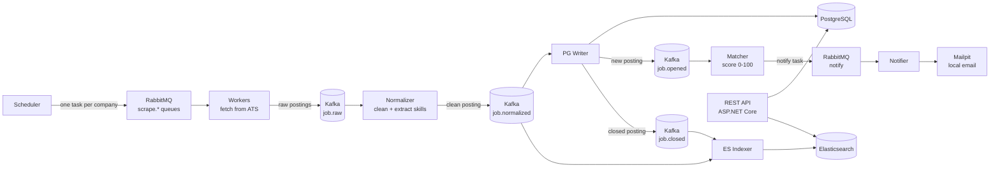

# Job Radar

An event-driven data pipeline that collects tech job postings from ~185 Israeli companies, normalizes them into one schema, stores and indexes them, and emails me when a new posting matches my profile.

I'm building it to learn end-to-end data engineering hands-on: message queues, an event log, a relational source of truth, a search index, and monitoring, all running locally with Docker Compose.

> **Status: work in progress.** Infrastructure, database schema, ATS fetchers and the first normalization step are done. See the [roadmap](#roadmap).

## Architecture



**How it flows**

1. Every 6 hours the scheduler publishes one task per company to RabbitMQ, routed by applicant-tracking system (Greenhouse, Comeet, ...).
2. Workers fetch raw postings at a polite rate (≤1 req/s per site) and write them unchanged to Kafka `job.raw`. Failed tasks retry with backoff and go to a dead-letter queue after 3 attempts.
3. The normalizer maps each ATS format to one schema, builds a stable `job_id` (`{ats}:{company}:{external_id}`) and a `content_hash`, and extracts skills. Unparseable messages go to `job.raw.dlq` without stopping the stream.
4. The PostgreSQL writer upserts postings idempotently and emits `job.opened` / `job.closed` events by comparing content hashes and scan results.
5. Elasticsearch keeps a rebuildable search index (closed jobs are kept with `status=closed`).
6. The matcher scores new postings against my profile (skills 60, seniority 25, work mode 15) and the notifier sends rate-limited emails.

## Key design decisions

| Decision | Why |
|---|---|
| RabbitMQ for scrape tasks, Kafka for events | Tasks need acks, retries and DLQs; events need replay and multiple independent consumers. |
| Raw data kept in Kafka, parsing done in the normalizer | A parsing bug can be fixed and the log replayed without re-scraping. |
| PostgreSQL is the source of truth | Kafka is the event log and Elasticsearch is a rebuildable copy for search. |
| Stable `job_id` + separate `content_hash` | Distinguishes "new", "changed" and "unchanged" postings, so reruns never create duplicates or duplicate alerts. |
| Matcher reads only `job.opened` | Alerts fire once per new posting, never for old ones. |

The full decision log (in Hebrew) is in [`docs/00-decisions.md`](docs/00-decisions.md).

## Tech stack

**Pipeline:** Python, pandas, psycopg · **Messaging:** RabbitMQ, Apache Kafka (KRaft) · **Storage:** PostgreSQL, Elasticsearch · **API:** ASP.NET Core, Dapper · **Ops:** Docker Compose, Prometheus, Grafana, GitHub Actions

## Repository layout

```
db/migrations/   SQL schema (shared by the Python workers and the API)
scripts/         ATS fetchers (Greenhouse, Comeet) and loaders
samples/         Real sample responses used for development and tests
notebooks/       pandas exploration of the raw ATS fields
docs/            Spec, decision log and work plan
```

## Running locally

```bash
cp .env.example .env              # set your own passwords
docker compose up -d              # PostgreSQL, RabbitMQ, Kafka
# apply the schema
for f in db/migrations/*.sql; do docker compose exec -T db psql -U noam -d jobradar < "$f"; done
# load the sample postings
docker compose run --rm app python scripts/load_jobs.py
```

RabbitMQ management UI: http://localhost:15672

## Roadmap

- [x] Docker Compose infrastructure with health checks (PostgreSQL, RabbitMQ, Kafka)
- [x] Database schema and migrations
- [x] Greenhouse and Comeet fetchers, sample data and pandas exploration
- [x] Normalization, `job_id` and `content_hash`, loading postings to PostgreSQL
- [ ] RabbitMQ scheduler and workers with retries and DLQ
- [ ] Kafka `job.raw` producer and normalizer consumer
- [ ] Idempotent PostgreSQL writer with open/closed events
- [ ] Elasticsearch indexer and search
- [ ] Matcher and email notifier (Mailpit)
- [ ] REST API (ASP.NET Core + Swagger)
- [ ] Monitoring (Prometheus, Grafana, consumer lag)
- [ ] Tests and CI in GitHub Actions
